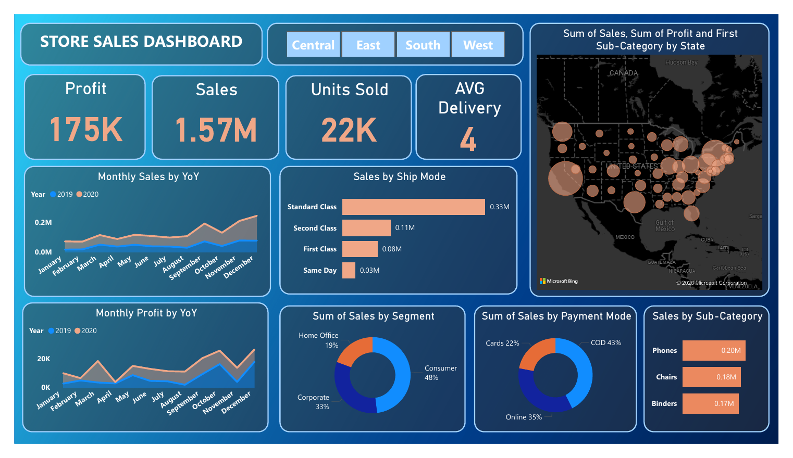
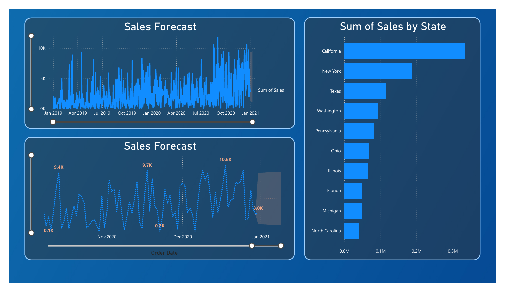
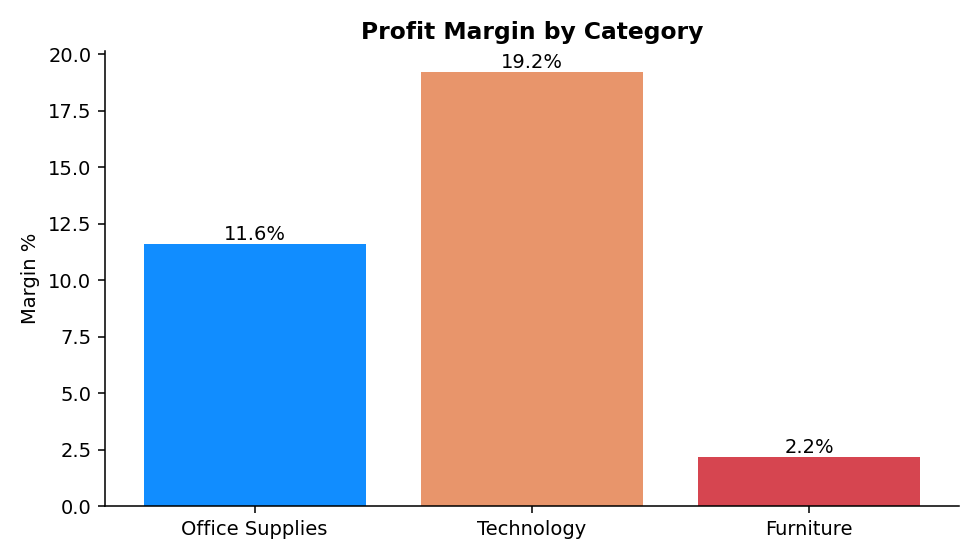
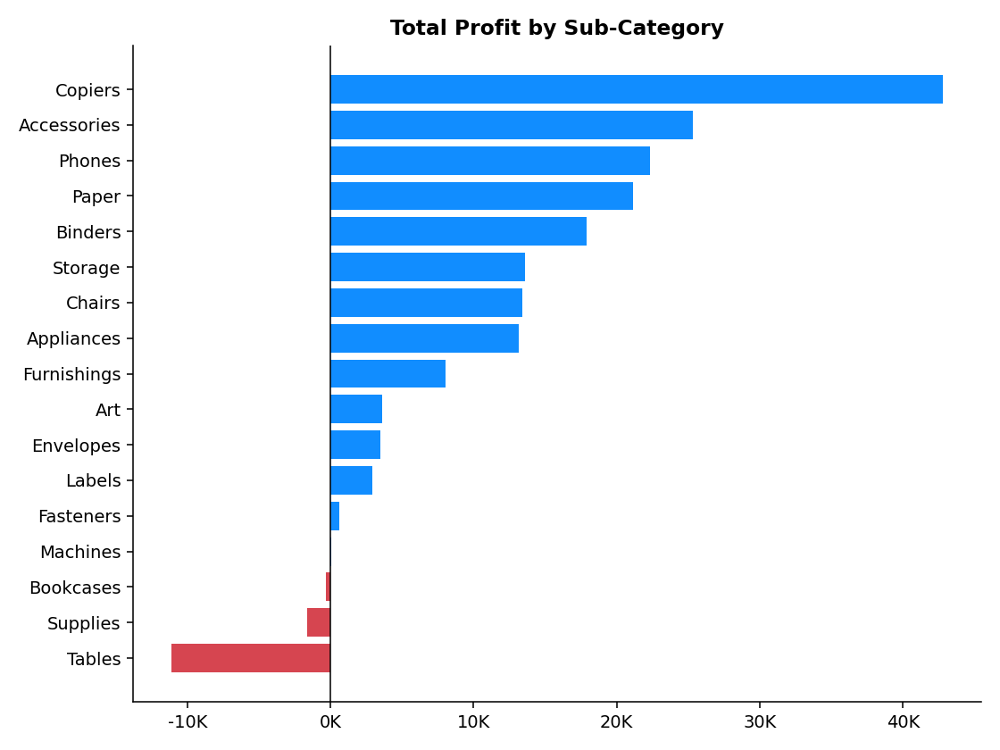
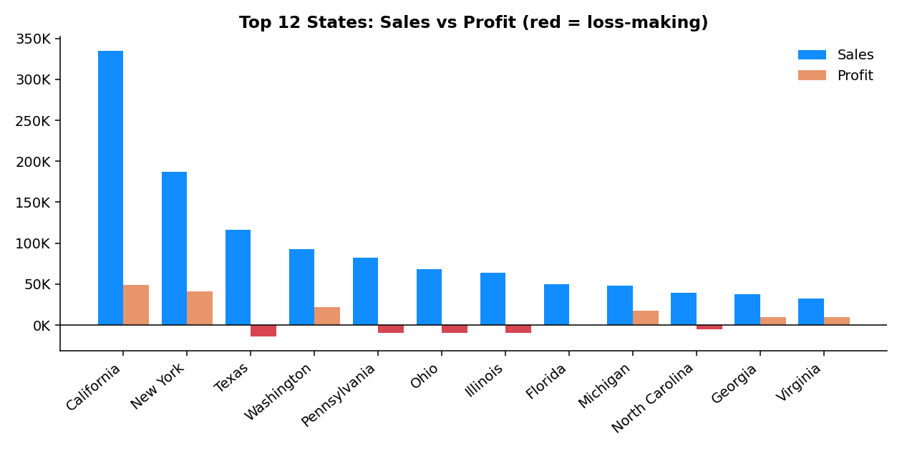
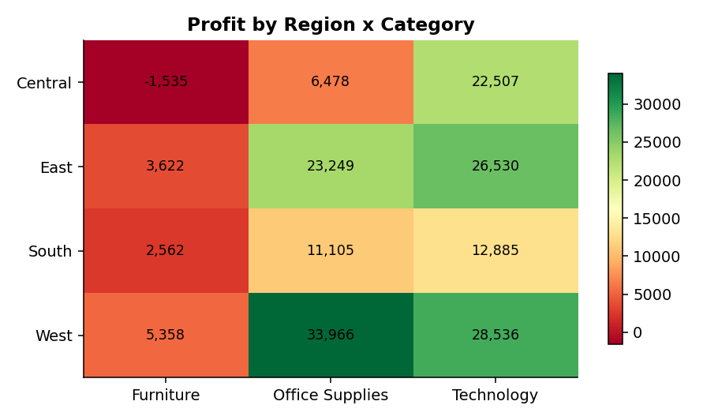

# 📊 Superstore Sales Dashboard: Excel + Power BI

An end-to-end business analytics project: raw sales data → cleaned in Excel → modelled and visualised in Power BI → validated in Python → turned into business recommendations.



## 🎯 Project Summary

A US retail store sells Furniture, Office Supplies and Technology across four regions. Management could see revenue but not **where growth was actually profitable**. I built an interactive two-page dashboard and analysed two years of transactions (5,901 order lines, 2019–2020) to find out.

## 🔑 Key Findings

| | |
|---|---|
| **$1.57M** sales · **$175K** profit | 11.2% overall margin, 3,003 orders, 773 customers |
| **Sales +77%, profit only +14%** | Margin fell from 14.5% (2019) to 9.3% (2020) |
| **Technology = 52% of profit** from 30% of sales | Furniture is 29% of sales but only 5.7% of profit (2.2% margin) |
| **Tables lose $11K** | Even though they are 7.6% of sales; Copiers earn a 72% margin |
| **10 of 49 states lose money (−$60K)** | Texas, Illinois, Ohio and Pennsylvania are the worst |
| **Q4 is ~50% of annual sales** | September–December drives the year; December 2020 was the peak |
| **Central region profit fell 62% in 2020** | While its sales grew 82% |

➡️ **Full analysis, charts and recommendations:** [`docs/PROJECT_REPORT.md`](docs/PROJECT_REPORT.md)

## 🖥️ Dashboard

**Page 1: Store Sales Dashboard.** Region slicer, KPI cards (Profit, Sales, Units Sold, Avg Delivery), monthly sales and profit year-over-year, sales by ship mode, segment and payment mode donuts, top sub-categories, and a state map.

**Page 2: Sales Forecast.** Daily sales with Power BI's built-in forecast, a zoomed view of the latest months, and the top 10 states by sales.



## 🛠️ Tools & Skills

- **Excel:** data profiling, cleaning, date and field preparation
- **Power BI Desktop:** data modelling, calculated column (`AvgShipDay`), slicers, KPI cards, area/bar/donut/map visuals, forecasting
- **Python (pandas, matplotlib):** independent validation of every dashboard KPI and the supporting charts
- **Analysis:** YoY trends, margin analysis, drill-down, loss analysis, concentration analysis
- **Communication:** insights turned into prioritised recommendations

## 📁 Repository Structure

```
superstore-sales-dashboard/
├── README.md
├── data/
│   ├── raw/SuperStore_Sales_Dataset.csv      # original data
│   └── processed/                            # cleaned data + summary tables (generated)
├── powerbi/
│   └── sales_dashboard.pbix                  # open in Power BI Desktop
├── dashboard/
│   └── sales_dashboard.pdf                   # exported dashboard
├── analysis/
│   └── sales_analysis.py                     # cleaning, KPI validation, charts
├── docs/
│   ├── PROJECT_REPORT.md                     # full process, insights, recommendations
│   └── DATA_DICTIONARY.md
├── images/                                   # dashboard screenshots + analysis charts
├── requirements.txt
└── LICENSE
```

## ▶️ How to Reproduce

1. **Dashboard:** open `powerbi/sales_dashboard.pbix` in Power BI Desktop. If prompted, point the data source to `data/raw/SuperStore_Sales_Dataset.csv`.
2. **Analysis:**
   ```bash
   pip install -r requirements.txt
   python analysis/sales_analysis.py
   ```
   This writes the cleaned dataset and summary tables to `data/processed/` and the charts to `images/`.

## 📈 Selected Analysis Charts

| | |
|---|---|
|  |  |
|  |  |

## ✅ Data Validation Note

Every dashboard KPI was reconciled against the raw data. During review I found that the *Sales by Ship Mode* chart inherited a Top-3 Sub-Category filter, so it totals $0.55M instead of $1.57M. The cause and fix are documented in [Section 8 of the report](docs/PROJECT_REPORT.md#8-dashboard-quality-review).

## 👤 Author

**Saiful** · BBA in Management Information Systems
🔗 [LinkedIn](https://www.linkedin.com/in/saiful-islam-roni-305812266/) · 💻 [GitHub](https://github.com/saifulroni)

*Dataset: SuperStore Sales Dataset (sample retail data, for learning and portfolio use).*
