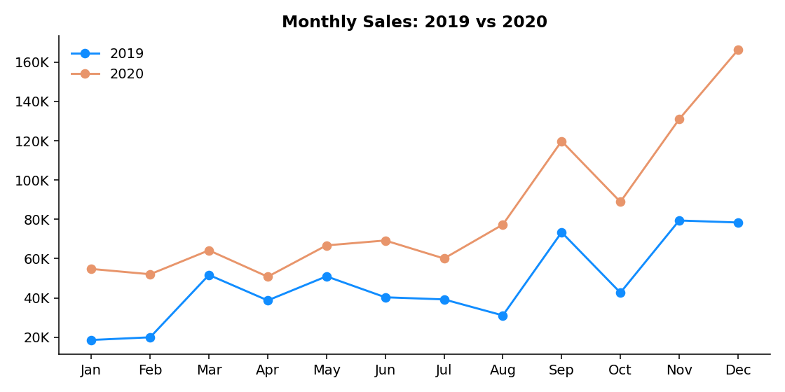
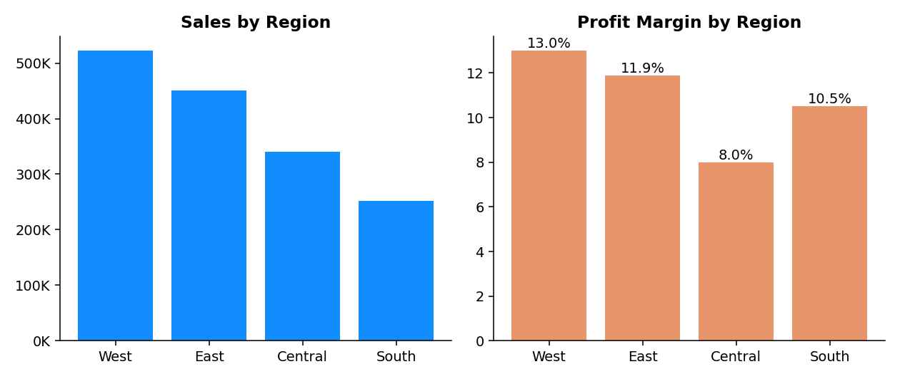

# Superstore Sales Analysis: Full Project Report

**Tools:** Microsoft Excel · Power BI Desktop · DAX · Python (pandas, matplotlib) for validation
**Dataset:** SuperStore Sales Dataset, 5,901 order lines, Jan 2019 – Dec 2020, United States
**Deliverables:** 2-page interactive Power BI dashboard, cleaned dataset, reproducible analysis script, this report

---

## Table of Contents
1. [Project Overview](#1-project-overview)
2. [Business Questions](#2-business-questions)
3. [Dataset](#3-dataset)
4. [Project Process](#4-project-process)
5. [Analysis Approach](#5-analysis-approach)
6. [Key Insights](#6-key-insights)
7. [Recommendations](#7-recommendations)
8. [Dashboard Quality Review](#8-dashboard-quality-review)
9. [Limitations](#9-limitations)
10. [Skills Demonstrated](#10-skills-demonstrated)
11. [Next Steps](#11-next-steps)

---

## 1. Project Overview

A retail store sells furniture, office supplies and technology to consumers, corporates and home offices across four US regions. Management can see total revenue, but not **where growth is profitable and where it is not**.

This project turns the raw transaction data into an interactive dashboard that lets a manager answer, in seconds:

- How are sales and profit trending year over year?
- Which products, regions and states drive revenue, and which destroy profit?
- How do customers pay, and how fast do we deliver?
- What does the near-term sales outlook look like?

**Headline result:** over two years the store generated **$1.57M in sales and $175K in profit (11.2% margin)**. Sales grew 77% from 2019 to 2020, but profit grew only 14%, so margin fell from 14.5% to 9.3%. The rest of this report explains where that margin went.

---

## 2. Business Questions

| # | Question | Answered by |
|---|----------|-------------|
| 1 | What are total sales, profit, units and delivery time? | KPI cards |
| 2 | How do sales and profit change month to month and year to year? | YoY area charts |
| 3 | Which sub-categories sell the most? | Sub-category bar chart |
| 4 | Where are sales concentrated geographically? | Map + state bar chart |
| 5 | Which customer segments and payment modes matter most? | Donut charts |
| 6 | How do shipping methods compare? | Ship mode bar chart |
| 7 | What is the sales outlook? | Forecast line charts |
| 8 | Can a manager focus on one region? | Region slicer |

---

## 3. Dataset

| Item | Detail |
|------|--------|
| Source file | `data/raw/SuperStore_Sales_Dataset.csv` |
| Rows / columns | 5,901 rows, 23 columns in the raw file |
| Orders / customers | 3,003 unique orders, 773 unique customers |
| Period | 1 Jan 2019 – 31 Dec 2020 |
| Geography | 49 US states in 4 regions (Central, East, South, West) |
| Measures | Sales, Quantity, Profit |
| Dimensions | Region, State, City, Segment, Category, Sub-Category, Ship Mode, Payment Mode, Customer, Product |

A full column-by-column description is in [`DATA_DICTIONARY.md`](DATA_DICTIONARY.md).

---

## 4. Project Process

### Step 1: Understand and profile the data (Excel)
<!-- EDIT: adjust this section to match exactly what you did in Excel -->
- Opened the CSV in Excel and reviewed every column, its data type and obvious ranges.
- Checked for blanks, duplicates and inconsistent values.
- Confirmed the grain of the data: **one row = one product line within an order** (an order can have several lines).

### Step 2: Clean and prepare the data
| Issue found | Action |
|-------------|--------|
| First column header was corrupted (`Row ID+O6G3A1:R6`, an Excel/BOM artefact) | Renamed to `Row ID` |
| Two completely empty helper columns (`ind1`, `ind2`) | Removed |
| `Returns` is `1` for returned lines and blank otherwise | Treated blank as "not returned" and created a clear 0/1 `Returned` flag |
| Dates stored as text in **day/month/year** format (e.g. `7/1/2019` = 7 January) | Parsed with an explicit day-first format so months are not mixed up |
| `Row ID` is not fully unique (ID 4918 appears twice for two different orders) | Not used as a key; `Order ID` + `Product ID` used instead |
| No duplicate rows, no negative shipping times | No action needed |

### Step 3: Create calculated fields
| Field | Logic | Used for |
|-------|-------|----------|
| `AvgShipDay` | `Ship Date − Order Date` in days, then averaged | "AVG Delivery" KPI card (3.93 days, shown as 4) |
| Year / Month | Taken from `Order Date` date hierarchy | YoY charts |
| Profit Margin % | `Profit ÷ Sales` | Analysis (margin by category, region, state) |

### Step 4: Load into Power BI and build the model
<!-- EDIT: confirm these modelling details match your .pbix -->
- Imported the cleaned data into Power BI Desktop as a single flat table (`SuperStore_Sales_Dataset`), suitable for this size and a single fact table.
- Set correct data types (dates, decimals, whole numbers) and set State to a **State/Province** geographic category so the map plots correctly.

### Step 5: Design the dashboard
**Page 1: Store Sales Dashboard (overview)**
| Visual | Fields | Purpose |
|--------|--------|---------|
| Region slicer (Central / East / South / West) | Region | Filters the whole page |
| 4 KPI cards | Sum of Profit, Sum of Sales, Sum of Quantity, Average of AvgShipDay | Headline numbers |
| Monthly Sales by YoY (area) | Month, Year, Sales | Trend and seasonality |
| Monthly Profit by YoY (area) | Month, Year, Profit | Profitability trend |
| Sales by Ship Mode (bar) | Ship Mode, Sales | Delivery-method mix |
| Sales by Sub-Category (bar, Top 3) | Sub-Category, Sales | Best sellers |
| Segment donut | Segment, Sales | Customer mix |
| Payment Mode donut | Payment Mode, Sales | Payment preferences |
| Filled/bubble map | State, Sales, Profit, Sub-Category | Geographic concentration |

**Page 2: Sales Forecast and State Ranking**
| Visual | Purpose |
|--------|---------|
| Sales Forecast (full period) | Daily sales Jan 2019 – Dec 2020 with Power BI's built-in forecast |
| Sales Forecast (zoomed) | Last ~3 months plus forecast band, with peak labels |
| Sum of Sales by State (Top 10) | Ranking of the highest-revenue states |

**Design choices:** one blue/orange palette (orange = key numbers, blue = secondary data), rounded cards on a gradient background for a consistent look, large KPI cards at the top so the headline is read first, and a single region slicer for simple interactivity.

### Step 6: Validate the dashboard
I rebuilt every headline number independently in Python (`analysis/sales_analysis.py`) and compared it with the dashboard. All KPIs, the segment split (48/33/19%), the payment split (43/35/22%) and the sub-category and state rankings reconcile exactly. One visual needed an explanation; see [Section 8](#8-dashboard-quality-review).

### Step 7: Document and publish
Exported the dashboard to PDF, wrote this report, and packaged everything in a GitHub-ready repository.

---

## 5. Analysis Approach

1. **Descriptive analysis:** totals, averages and shares by every dimension (region, state, category, sub-category, segment, ship mode, payment mode).
2. **Trend analysis:** monthly and quarterly sales and profit, compared 2019 vs 2020.
3. **Profitability analysis:** profit margin (profit ÷ sales) rather than raw profit alone, because high sales can hide low or negative margins.
4. **Drill-down:** when a category or region looked weak, I broke it into sub-category, region × category and state to find the cause.
5. **Loss analysis:** isolated the 1,098 loss-making order lines to see which products and states account for the losses.
6. **Concentration analysis:** share of sales held by the top states and top 20% of customers.
7. **Validation:** every dashboard number cross-checked against an independent calculation.

---

## 6. Key Insights

### 6.1 Headline KPIs
| KPI | Value |
|-----|-------|
| Total sales | **$1,565,804** |
| Total profit | **$175,262** (11.2% margin) |
| Units sold | 22,317 |
| Orders / customers | 3,003 / 773 |
| Average order value | $521 |
| Average delivery time | 3.9 days |
| Returned lines | 287 (≈ $88K of sales, 5.6%) |

### 6.2 Growth is strong but profit is not keeping up
| | 2019 | 2020 | Change |
|---|---|---|---|
| Sales | $564,680 | $1,001,125 | **+77%** |
| Profit | $81,823 | $93,439 | **+14%** |
| Profit margin | 14.5% | 9.3% | **−5.2 pts** |
| Orders | 1,315 | 1,688 | +28% |

Sales grew far faster than profit. In 2020 the business grew mostly by selling **more lower-margin items**, not by improving profitability.

### 6.3 Strong seasonality
- Sep–Dec generates about **49% of sales in 2019 and 51% in 2020**; Nov–Dec alone is 28–30%.
- **December 2020 was the biggest month** ($166K) and Q4 2020 sales ($386K) were roughly double Q4 2019 ($200K).
- January–February are consistently the weakest months. Inventory, staffing and promotions should follow this curve.

### 6.4 Technology earns the money; Furniture earns almost nothing

| Category | Sales | Profit | Margin |
|----------|-------|--------|--------|
| Office Supplies | $643.7K (41%) | $74.8K | 11.6% |
| Technology | $470.6K (30%) | **$90.5K** | **19.2%** |
| Furniture | $451.5K (29%) | $10.0K | **2.2%** |

Technology generates **52% of all profit from 30% of sales**. Furniture produces 29% of sales but only **5.7% of profit**, and its profit fell from $7.0K to $3.0K in 2020 while sales grew 31%.

### 6.5 Some best sellers are not profitable

- The dashboard's top sellers are **Phones ($197K), Chairs ($182K) and Binders ($175K)**. Phones are healthy (11% margin), but **Chairs only earn 7.4%**.
- **Tables lose money: −$11.1K on $119K of sales (−9.3% margin).** Tables are 7.6% of sales yet the biggest drag on profit.
- **Machines break even** ($38 profit on $92K) and Bookcases and Supplies are also negative.
- **Copiers are the star:** 71.6% margin ($42.8K profit on just $59.7K sales, 38 orders).
- Accessories (20.7%), Paper (21.2%) and Envelopes (21.2%) are consistently high-margin.
- Binders look profitable overall (+$17.9K) but contain the **single largest pool of loss-making lines (−$22.7K)**, which points to discounting or pricing problems on specific orders.

### 6.6 Geography: California is the engine, but 10 states lose money

- **California ($335K) and New York ($187K)** are the two biggest markets; the top 3 states account for **41%** of sales and the top 5 for **52%**.
- **10 of 49 states are loss-making, losing $60K in total.** The worst are **Texas (−$14.1K), Illinois (−$9.6K), Ohio (−$9.3K) and Pennsylvania (−$9.3K)**, all with margins around −11% to −15% despite healthy sales.
- Texas is the third-largest state by sales ($116K) but loses money in both Furniture (−$6.6K) and Office Supplies (−$9.9K).
- Smaller states can be very profitable: **Michigan 36%, Virginia 29%, Georgia 27%, Washington 23%, New York 22%**.

### 6.7 Regions: West leads, Central is the weak spot

| Region | Sales | Profit | Margin |
|--------|-------|--------|--------|
| West | $522K | $67.9K | **13.0%** |
| East | $450K | $53.4K | 11.9% |
| Central | $341K | $27.5K | **8.0%** |
| South | $252K | $26.6K | 10.5% |

In 2020 **Central's sales grew 82% but profit fell from $19.9K to $7.6K**, and South's profit fell from $17.7K to $8.8K. West and East both increased profit strongly (+82% and +65%). Central loses money on Furniture (−$1.5K) and earns most of its profit ($22.5K of $27.5K) from Technology.

### 6.8 Customers and payment
- **Consumer 48%, Corporate 33%, Home Office 19%** of sales. Margins are almost identical (10.8–11.9%), so **segment is not a profitability lever**; Home Office is slightly best at 11.9%.
- **Customers are loyal:** 89% of customers ordered more than once (average 3.9 orders each), and the **top 20% of customers produce 48% of sales**.
- **Cash on Delivery is the #1 payment method (43% of sales)**, ahead of Online (35%) and Cards (22%). COD orders also have the highest average value (~$389) and best margin (12.3%), while Online has the lowest (9.8%).

### 6.9 Delivery
- Average delivery time is **3.9 days** and is nearly identical across regions (3.85–4.04 days).
- **Standard Class is 58% of sales**; Same Day is only 6%.
- Ship modes behave as expected: Same Day ≈ 0 days, First Class ≈ 2.1, Second Class ≈ 3.2, Standard ≈ 5.0 days.

### 6.10 Forecast
The Power BI forecast on the daily sales line projects continued activity into early 2021 with a wide confidence band, reflecting how volatile daily sales are (daily values range from near zero to ~$10K+). Combined with the seasonality above, expect **January 2021 to be quieter than December 2020** and treat the forecast as a directional guide, not a precise target.

---

## 7. Recommendations

| Priority | Recommendation | Evidence |
|----------|----------------|----------|
| 1 | **Fix Table pricing/discounts** or reduce Table volume, especially in the East and South | Tables lose $11.1K; every region is negative |
| 2 | **Investigate loss-making states** (Texas, Illinois, Ohio, Pennsylvania, North Carolina, Colorado): review shipping costs, discount levels and product mix | 10 states lose $60K combined |
| 3 | **Grow Technology** (Copiers, Accessories, Phones) with targeted promotion and bundles | 19% margin, 52% of profit |
| 4 | **Review Machines, Bookcases and Supplies**: raise prices, renegotiate supplier cost or drop the worst lines | Break-even or negative profit |
| 5 | **Diagnose Central region** margin decline in 2020 | Sales +82%, profit −62% |
| 6 | **Plan for Q4 peak:** stock, staffing and campaigns ahead of September | ~50% of annual sales in Sep–Dec |
| 7 | **Protect repeat customers** with loyalty offers | Top 20% of customers = 48% of sales |
| 8 | **Review the 5.6% return rate** by product and state | $88K of sales returned |

> A key analytical lesson: **sales rank and profit rank are very different.** Managing by revenue alone would keep pushing the store towards Tables, Chairs and Texas.

---

## 8. Dashboard Quality Review

During validation I found points worth knowing about. Documenting them shows the dashboard was tested, not just built.

1. **Ship Mode chart is filtered to the top 3 sub-categories.** Its bars (0.33M, 0.11M, 0.08M, 0.03M) add up to **$0.55M, not $1.57M**. The reason is a Top-3 Sub-Category visual filter that was copied from the Sub-Category chart. I confirmed that filtering the raw data to Phones, Chairs and Binders reproduces the four values exactly. The correct all-data figures are: **Standard $912K, Second $315K, First $243K, Same Day $96K.**
   **Fix:** in Power BI, select the Ship Mode visual, open the Filters pane and remove the "Sub-Category: Top 3" filter.
2. **Sub-Category chart shows only 3 of 17 sub-categories.** This is intentional (Top N) but the title should say "Top 3 Sub-Categories by Sales".
3. **State bar chart shows only the Top 10 states** by sales; title should say "Top 10".
4. **Dashboard shows sales rank only.** Sub-category and state charts rank by sales, which hides loss-makers like Tables and Texas. Adding a profit-margin visual would surface them (see Next Steps).
5. **Average delivery shows "4"** (rounded from 3.93). Showing one decimal place would be more precise.

---

## 9. Limitations

- Data covers only two years and one store, so trends and the forecast are indicative.
- The dataset has **no discount or cost column**, so the root cause of low-margin products (discounting vs high cost vs shipping) cannot be proven, only inferred.
- Profit on returned items is included as recorded; the dataset does not say whether refunds were already deducted.
- The forecast is Power BI's automatic model on very volatile daily data and has a wide uncertainty band.
- Row-level analysis uses order lines; a few figures (e.g. average order value) were calculated at order level.

---

## 10. Skills Demonstrated

- Data cleaning and preparation in Excel (header repair, date parsing, removing blank fields, flagging returns)
- Data modelling, calculated columns and measures in Power BI
- Dashboard design: KPI cards, slicers, area/bar/donut/map visuals, YoY comparison, forecasting
- Analytical thinking: moving from "what happened" (sales) to "why it matters" (profit margin)
- Data validation with an independent Python script and quality-checking my own work
- Business communication: turning numbers into prioritised recommendations
- Documentation and version control with Git/GitHub

---

## 11. Next Steps

- Add a **Profit Margin by Sub-Category** visual and a **loss-making states** table to the dashboard.
- Add a **Year slicer** and a **Category slicer** alongside the Region slicer.
- Create explicit DAX measures (`Total Sales`, `Total Profit`, `Profit Margin %`, `Sales YoY %`) in place of implicit aggregations.
- Add tooltips on the map showing margin as well as sales.
- If discount or cost data becomes available, run a root-cause analysis on loss-making products.
- Publish the report to Power BI Service and link the live version in the README.
